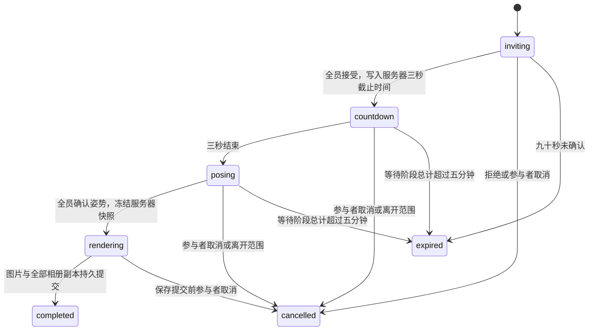
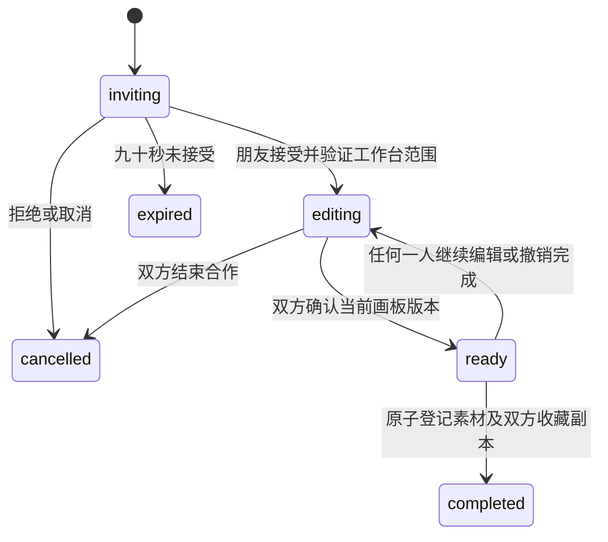

# 像素合照、合作拼豆与工位留言

状态：待用户评审。本文件是设计，不代表功能已经实现。

## 目标与现有边界

为八人像素世界增加三种人与人之间的互动：一起拍照、一起制作物品、给离线朋友留下留言和实物礼物。继续使用刚统一的橄榄绿、米色、金色方角界面；人物、场景投影、个人拼豆、电脑 App、Franco 电话和 Laura 萨克斯继续沿用现有实现。

现有接入点：`server/app.mjs` 的控制权校验、SSE 世界快照和整次请求持久提交；`server/life.mjs` 的物品、收藏和经历；`server/album.mjs` 的相册权限与图片分块；`server/rewards.mjs` 的拼豆作品素材；`src/perler-board.ts` 的 16×16 画板；`src/multiplayer/social.ts` 的附近互动；`shared/workstations.json` 的固定工位归属。

三项采用独立业务模块，共享既有鉴权、事务、同步和物品流转边界，不将新的会话状态塞进现有赠送/邀约状态枚举。

## 用户可见流程

| 玩法 | 入口 | 完成结果 |
| --- | --- | --- |
| 像素合照 | 附近人物的“更多 → 合照”，选择当前场景附近的在线成员，最多八人 | 每个参与者的现有场景相册都有一份合照，记录拍摄时间、地点与参与者 |
| 合作拼豆 | 拼豆工作台的“邀请一起拼”，选择拼豆室内附近的在线朋友 | 双方各获得一份带两人署名的作品，默认收进收藏，可拿出后赠送 |
| 工位留言 | 走近朋友在胡同办公室的固定工位，点击独立的像素便签入口 | 朋友上线后收到未读提示，可以打开、领取附件、回复、收藏便签 |

合照中的姿势选择按原描述保留为“大家确认 → 3 秒预备倒计时 → 选择姿势 → 各自确认姿势 → 拍摄”。倒计时结束后不抢拍，等每个人选好。初始姿势为正面站立、挥手、比耶；使用人物像素素材或配套像素姿势，不用表情符号替代人物动作。

## 1. 像素合照

### 会话与呈现

发起时服务器验证发起者控制权、成员领取状态、真实在线状态、同场景和距离，邀请范围为距发起者 70 个游戏坐标单位以内。NPC 与离线替身不代替本人确认。会话成员列表固定，发起者视为已同意，其他成员逐个接受或拒绝。整组必须同意后才进入倒计时，任一拒绝取消本轮；需要调整名单时重新发起。

确认界面展示地点、参与者以及“照片仅参与者可见”。使用服务器时间和截止时间显示三秒预备倒计时。进入姿势阶段后每人选择自己的姿势并确认；换姿势撤销自己的确认。所有人确认时冻结会话快照：场景、参与者、姿势、物件状态、服务器拍摄时间与渲染版本。

客户端根据冻结快照在专用像素画布合成照片，复用回看中的场景和人物绘制能力，不截取工具栏、聊天文字或未经邀请的旁观者。多人按稳定顺序排列在像素合照画面中；真实场景位置不改变。已同意且仍在同一场景范围内才可参加冻结。输出无损 PNG，保证像素边缘；真实相册照片继续用既有 JPEG。

每个参与者获得独立相册记录，默认只对本轮参与者可见，可独立删除或使用现有相册分享设置，不影响别人的副本。日期、地点和参与者来自服务器冻结信息，上传者不能自行填写或冒充。素材上传和全部相册记录在同一持久事务完成；配额不足时保持待保存，提示清理后重试。

### 状态

倒计时由服务器截止时间计算，不依赖发起者网页定时器。刷新读取原会话。参与者暂时断线保留状态，等待重新上线；尚未冻结且到期则终止。冻结后的快照保留，任一参与者可按同一快照重试合成与上传；上传权限不依赖发起者仍在线。重复保存返回原结果，不能生成第二组照片。

保存期间取消与保存请求通过同一会话版本串行竞争；已完成的拍摄不会被旧取消请求改回未完成。PNG 只允许受限尺寸的静态栅格，限制解码后像素数、字节数和结构，响应明确使用正确 MIME 与 `nosniff`。继续保留既有 JPEG 校验和照片 ACL；旧相册记录的 MIME 默认为 `image/jpeg`，不重写已有图片或权限。

## 2. 合作拼豆

### 会话与编辑

只在拼豆室建立双人会话，不自动把朋友传送过来。双方空手且在工作台附近，邀请确认后打开专用合作画板；个人画板和个人撤销历史保留。一个成员同一时间只参加一个需要确认/编辑的合照或合作拼豆会话。

画板仍是 16×16、已有十六种颜色和底图。邀请者编辑左八列，朋友编辑右八列，两边都看到整幅图；显示双方名字与分区。底图在发起时确定，合作期间不悄悄替换。支持放豆、擦除、拖动连续放豆和撤销自己最近的笔画。

发送每次笔画的格子补丁而非整个画板。服务器校验成员、所在场景、会话状态、自己的分区、格子坐标、颜色和请求编号。补丁带各格子预期旧值；不同格子的笔画可合并，冲突返回当前值，前端保留未确认笔画并提示重试。相同请求不会重复落笔。撤销仅限自己的笔画，且不覆盖后来已改变的格子。

双方点击“完成这一半”，都完成后可提交“熨烫作品”。有人继续修改则撤销该人的完成状态；熨烫针对双方确认的同一版本。一幅非空作品成功熨烫只登记一个素材作品，作者名单包含双方，并为双方各登记一个个人纪念副本。默认直接进入收藏，不因手中物品占用而丢失。作品署名跟随素材记录，后续放入背包、取出和赠送仍可查看。

### 状态

已接受画板持久保存，离开拼豆室或断线时暂停编辑权限，回到工作台后继续，不自动删除草稿。单方可以离开；结束草稿需双方确认，仍在离线的一方下次上线可以回应。完成后禁止编辑、清空或再次熨烫；重新合作建立新画板。收藏配额或持久提交失败保留 ready 状态，重试不重复发放。

## 3. 工位留言

### 投递、附件与阅读

初期对应 `shared/workstations.json` 已有的胡同办公室八个固定工位。服务器由工位推导收件人，不能靠客户端指定任意工位归属。投递时必须走近该工位，留言最多二百字，可附带当前手中的一件咖啡、食物、盲盒或拼豆作品。

留言入口使用工位旁独立像素便签，不占用电脑点击区域；新收到的留言也能从“更多 → 留言”查看。收件箱仅展示自己的收件与发件，不通过公共场景快照广播内容。对方上线后显示未读数量；点开后标记已读，展示发送者、投递日期、来源工位和附件。

附带物品时，投递和从手中扣物品处于同一事务，校验物品 revision 和现有赠送锁。保存真实物品名称、调味和来源到附件托管记录；成功投递才清空手中物品。便签可以离线等待，不自动过期，不消耗或销毁附件。

领取附件可选择手上，或使用现有背包规则放进背包；可收藏的物品也能直接放进收藏。手、背包或收藏容量不足时原附件继续等待领取。每个附件最多领取一次。接收者可以先阅读便签而暂不领取附件。

回复以原便签为线程，双方都可查看；新回复产生对方的未读提示。每次回复原子递增线程版本，按个人已读版本计算未读，不依赖跨实例时钟精度；自己的回复不会给自己新增未读。初版回复为文字，附带新礼物走新的投递。收藏便签是保存这段文字与线程入口，放在留言界面的“收藏便签”标签页，不把文字便签伪装成现有实物背包格子。

### 状态

便签阅读状态与附件状态分开保存：

- 便签：`unread → read`；是否收藏为独立个人标记。
- 附件：`escrow → claimed`；无附件则无此状态。
- 回复：每条独立作者、时间和读游标，只允许原线程双方读取、发送。

重复投递、重复领取、重复回复都按原请求编号返回已有结果。两窗口同时领取只能有一次物品转移。先已读后领取、领取后刷新、回复后收藏均不修改原赠送事实。

## 数据与接口边界

建议新增独立的 `server/group-photo.mjs`、`server/cooperative-perler.mjs`、`server/desk-notes.mjs`，以及对应客户端 UI 模块和共享类型。`server/app.mjs` 只负责路由、控制权、位置上下文及持久提交，业务转移在模块事务中完成。

| 存储 | 关键数据与约束 |
| --- | --- |
| `social_sessions` | 会话编号、玩法、发起者、场景、阶段、版本、截止时间、冻结结果；玩法与状态有白名单 |
| `social_session_members` | 会话和账号复合主键、邀请回应、姿势/完成状态、最后有效动作 |
| `social_activity_claims` | 账号主键与活跃会话，防止不同实例给同一人建立冲突会话 |
| `cooperative_boards` | 会话主键、256 个颜色格、画板版本、分区成员；所有编辑按此权威行提交 |
| `cooperative_strokes` | 会话、作者、请求编号、已提交格子与旧值；支持幂等和条件撤销 |
| `desk_notes` | 编号、发件人、收件人、工位、文字、时间、读状态、附件原值与领取状态 |
| `desk_note_replies` | 回复编号、原便签、作者、正文、日期；写入后正文不被旧副本覆盖 |
| `desk_note_preferences` | 账号与便签复合主键、收藏标记与读游标 |
| 现有相册/作品扩展 | 合照来源会话、服务器拍摄信息、MIME；拼豆作者与来源合作会话 |

新增接口按读写职责分开：

- `GET /api/social-play`：自己的会话和状态、服务器时钟；公共信息仅含可加入的邀请。
- `POST /api/group-photo`：发起、回应、选择姿势、确认、取消、冻结与保存。
- `POST /api/cooperative-perler`：发起、回应、笔画、撤销、完成一半、熨烫、结束回应。
- `GET /api/desk-notes`：自己的收件箱、发件箱、线程或收藏便签。
- `POST /api/desk-notes`：投递、阅读、领取附件、回复、收藏切换。

所有写操作验证当前控制窗口，并使用 `requestId` 和必要的版本/物品 revision。终态回放先校验身份，再返回原结果，不能利用旧请求对新会话重复写入。成员身份来自登录账号，不能相信请求中的作者、日期、结果或领取状态。

参与者邀请和自己的未读提示通过既有用户级 SSE 快照传递，客户端收到版本变化后读取画板/便签详情，不把 256 格数据与私人文字塞进所有人的高频位置广播。断线重连使用持久状态恢复；PartyKit 继续负责位置，不承载最终物品、照片或画板权威状态。

Turso 继续复用整次请求版本检查、事务提交和回滚回执。新增活跃会话账号占用需补充远端约束，不能仅依赖进程 Map。后台倒计时只计算展示，不在未确认远端提交时发布完成事件；实际状态推进由幂等 POST 完成。GET 不提交新的物品或作品。

## 验收与执行顺序

先实现持久模型与状态机测试，再依次接入工位留言、合作拼豆、合照及现有相册，最后统一桌面/触屏界面与联调。各模块保持独立，可以定位失败和回滚，不需要新场景、付费服务或新增外部账号。

必须通过：

1. 合照接受/拒绝/取消/超时、三秒时钟、姿势确认、刷新、断线和上传重试；参与者副本和非参与者权限；PNG 与已有 JPEG 相册兼容。
2. 双浏览器同时拼不同分区、乱序补丁、越权格子、条件撤销、修改后取消完成、重复熨烫、作者随赠送保留，个人拼豆继续正常。
3. 离线投递、错误工位、附件扣除与领取、手满和背包满、重复请求、两窗口领取竞争、线程权限、未读与收藏持久恢复。
4. 两独立副本争抢同一参与者、同时编辑和同时领取、持久提交失败回滚、冷启动恢复，不能产生重复物品或重复作品。
5. 现有测试与生产构建；独立临时数据库的真实双浏览器流程、桌面与手机操作。测试不能消耗真实世界的永久角色名额。
6. 像素素材清晰，桌面控件至少 36px 高，触屏至少 44×44px；便签不截获电脑 App 点击，社交面板不被摇杆覆盖。不得新增通用 SaaS 外壳或虚构品牌。

本次设计不包含部署、生产数据修改或消息发送；上述新功能需在本地实现和验证后再交付。
